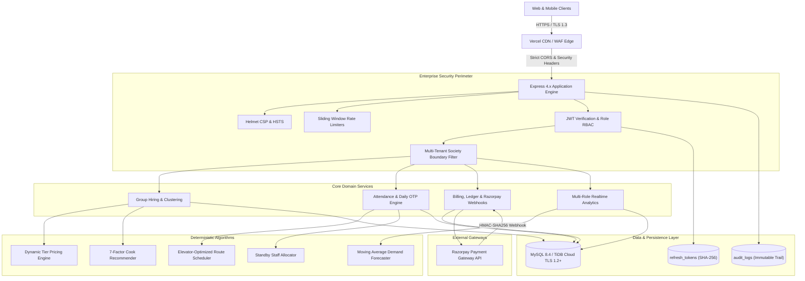

# SocietyCook Enterprise Architecture Documentation

**Platform:** SocietyCook Hyperlocal Enterprise Platform  
**Version:** 4.0.0  
**Pattern:** Enterprise Modular Monolith with Multi-Tenant Logical Isolation  

---

## 1. System Architecture & Component Diagram

---

## 2. Multi-Tenant Logical Separation Model
- **Tenant Boundary:** Every residential apartment society (`societies.id`) acts as an isolated tenant boundary.
- **Tenant Enforcement:**
  - Authenticated user records embed `society_id` within signed JWT claims.
  - Route handlers enforce `requireSameSocietyOrAdmin` middleware or parameterized SQL clauses `WHERE society_id = ?`.
  - Residents and cooks are strictly denied cross-tenant reads or writes.
- **Data Protection:** Financial ledgers, household rosters, apartment flat numbers, and phone numbers are never returned in public or cross-society queries.

---

## 3. Technology Stack Specification
- **Frontend:** React 19, Vite 6, Tailwind CSS 4, React Router 7, TanStack Query 5, Lucide Icons, Recharts.
- **Backend:** Node.js 20 LTS, Express 4, Socket.IO 4, Zod 4 (patched against ReDoS), Bcrypt.js, Helmet 8, Express Rate Limit 7.
- **Database:** MySQL 8.4 / TiDB Cloud Serverless, connection pooling with keep-alive, parameterized prepared statements (`execute`), ACID transaction isolation.
- **Containerization:** Multi-stage Dockerfile based on Alpine Linux executing under unprivileged user `societycook` (`UID 1001`).
