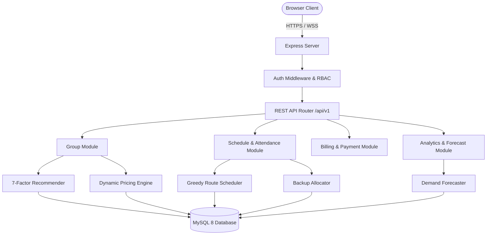

# Architecture Documentation
## SocietyCook – System Design & Component Structure

---

## 1. Modular Monolith Design Philosophy
SocietyCook uses a modular monolith pattern instead of premature microservices:
- **Low Operational Overhead:** Single Node.js runtime process simplifies deployment on low-cost compute (AWS ECS, Docker, or DigitalOcean droplet).
- **Strong Relational Guarantees:** MySQL foreign keys and ACID transactions maintain strict integrity across users, memberships, schedules, and billing ledgers.
- **Independent Domain Modules:** Services, algorithms, and controllers are strictly decoupled by clear interface boundaries.



---

## 2. Directory Structure
```
SocietyCook/
├── backend/
│   ├── migrations.js          # Non-destructive migration runner (31 tables/extensions)
│   ├── seed.js                # Realistic seed data for societies, cooks, clusters
│   ├── server.js              # Express app bootstrap, sockets, Swagger mount
│   ├── src/
│   │   ├── algorithms/        # Real heuristic algorithms
│   │   │   ├── backupAllocator.js
│   │   │   ├── forecasting.js
│   │   │   ├── pricingEngine.js
│   │   │   ├── recommender.js
│   │   │   └── scheduler.js
│   │   ├── config/            # Env and MySQL connection pool
│   │   ├── docs/              # Swagger/OpenAPI 3.0 specification
│   │   ├── jobs/              # Node-cron background jobs
│   │   ├── middlewares/       # Auth, RBAC, audit logger, error handler
│   │   ├── routes/            # Express route handlers
│   │   ├── services/          # Business logic transactions
│   │   └── sockets/           # WebSocket event emitters
│   └── tests/                 # Vitest test suite (Unit & Integration)
├── frontend/
│   ├── src/
│   │   ├── components/        # Navbar, Persona Switcher, Badges
│   │   ├── context/           # AuthContext & Dark Mode Provider
│   │   ├── pages/             # LandingPage, DashboardHub, GroupHub, etc.
│   │   ├── services/          # Axios API client
│   │   ├── App.jsx            # React Router table
│   │   ├── main.jsx           # Entrypoint
│   │   └── style.css          # Tailwind CSS styles
│   └── package.json
├── docker-compose.yml         # Containerized MySQL 8.0 & multi-service stack
└── README.md
```
