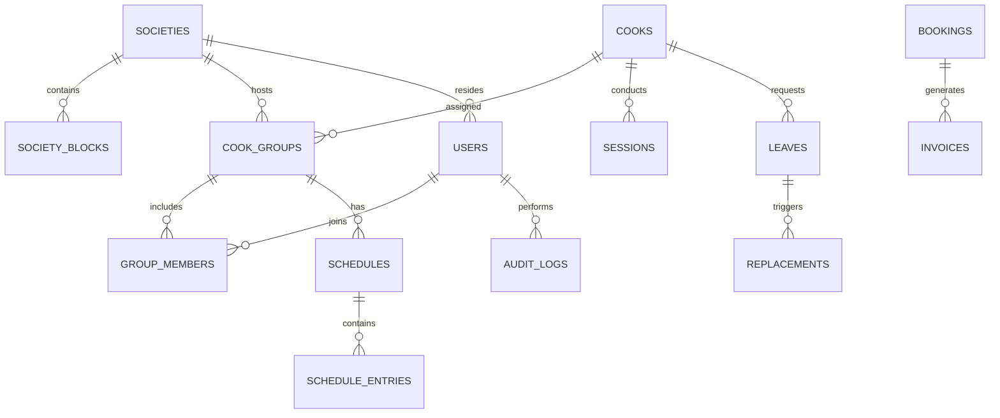

# Database Architecture & Schema Reference
## SocietyCook v2 MySQL 8.0 Schema

The database design uses strict foreign key constraints, UTF8MB4 collation, cascading relationships, and optimized indexing for fast geographical and temporal queries.

---

## 1. Core Tables

### 1. `societies`
Stores gated residential apartment communities.
- `id` (INT, PK, AUTO_INCREMENT)
- `name` (VARCHAR 255, NOT NULL)
- `address`, `city`, `state`, `postal_code`
- `gate_pass_prefix` (VARCHAR 50, default 'SC-PASS')
- `total_flats` (INT, default 200)

### 2. `society_blocks`
Represents individual towers or wings (e.g. Tower A, Tower B).
- `id` (INT, PK, AUTO_INCREMENT)
- `society_id` (INT, FK -> societies.id)
- `block_name` (VARCHAR 100)
- `floors_count` (INT, default 14)
- `flats_per_floor` (INT, default 4)

### 3. `users`
System accounts across 4 distinct roles.
- `id` (INT, PK, AUTO_INCREMENT)
- `society_id` (INT, FK -> societies.id)
- `block_name`, `flat_number`
- `name`, `email` (UNIQUE), `phone`, `password_hash`
- `role` (`RESIDENT`, `COOK`, `SOCIETY_MANAGER`, `ADMIN`)
- `status` (`ACTIVE`, `PENDING_VERIFICATION`, `SUSPENDED`)

### 4. `cooks`
Professional cook profiles and service metrics.
- `id` (INT, PK, AUTO_INCREMENT)
- `user_id` (INT, FK -> users.id)
- `experience_years`, `bio`, `specialties`, `cuisines`
- `rating_avg` (DECIMAL 3,2, default 4.80)
- `reliability_score` (DECIMAL 5,2, default 98.00)
- `punctuality_score` (DECIMAL 3,2, default 0.98)
- `police_verification_status` (`CLEARED`, `PENDING`, `REJECTED`)
- `gate_clearance_code` (VARCHAR 100)

### 5. `cook_groups`
Community cook hiring clusters.
- `id` (INT, PK, AUTO_INCREMENT)
- `society_id` (INT, FK -> societies.id)
- `assigned_cook_id` (INT, FK -> cooks.id, NULLABLE)
- `name` (VARCHAR 255)
- `meal_service` (`BREAKFAST`, `LUNCH`, `DINNER`, `MULTIPLE`)
- `dietary_requirements` (`VEGETARIAN`, `NON_VEGETARIAN`, `JAIN`, `MIXED`)
- `budget_per_household` (DECIMAL 10,2)
- `status` (`DRAFT`, `RECRUITING`, `THRESHOLD_REACHED`, `MATCHING`, `ACTIVE`, `PAUSED`, `CANCELLED`)
- `min_members`, `max_members`, `current_members`

### 6. `group_members`
Households participating in a group.
- `id` (INT, PK, AUTO_INCREMENT)
- `group_id` (INT, FK -> cook_groups.id)
- `resident_id` (INT, FK -> users.id)
- `preferred_slot` (VARCHAR 50)
- `dietary_preferences` (TEXT)
- `monthly_price` (DECIMAL 10,2)

### 7. `schedules` & `schedule_entries`
Optimized route calendar.
- `schedule_entries.schedule_id` (FK -> schedules.id)
- `resident_id`, `flat_number`, `block_name`
- `start_time`, `end_time` (e.g. 19:00:00 to 19:45:00)
- `buffer_minutes` (INT, default 15)

### 8. `sessions`
Daily cooking appointments with OTP authentication.
- `id` (INT, PK, AUTO_INCREMENT)
- `booking_id`, `cook_id`, `resident_id`, `society_id`
- `service_date` (DATE)
- `start_time`, `end_time`
- `otp_code` (VARCHAR 6) - Generated for resident to verify arrival
- `status` (`SCHEDULED`, `IN_PROGRESS`, `COMPLETED`, `DISPUTED`, `MISSED`)
- `check_in_time`, `check_out_time`

### 9. `leaves` & `replacements`
Cook absence and automated backup dispatch.
- `leaves.cook_id`, `start_date`, `end_date`, `reason`
- `replacements.replacement_cook_id` (FK -> cooks.id)
- `replacements.status` (`PENDING`, `DISPATCHED`, `COMPLETED`)

### 10. `audit_logs`
Non-repudiable ledger of operational and security changes.
- `actor_id` (INT)
- `action` (VARCHAR 100)
- `entity_type`, `entity_id`
- `diff_payload` (JSON)
- `created_at` (TIMESTAMP)
