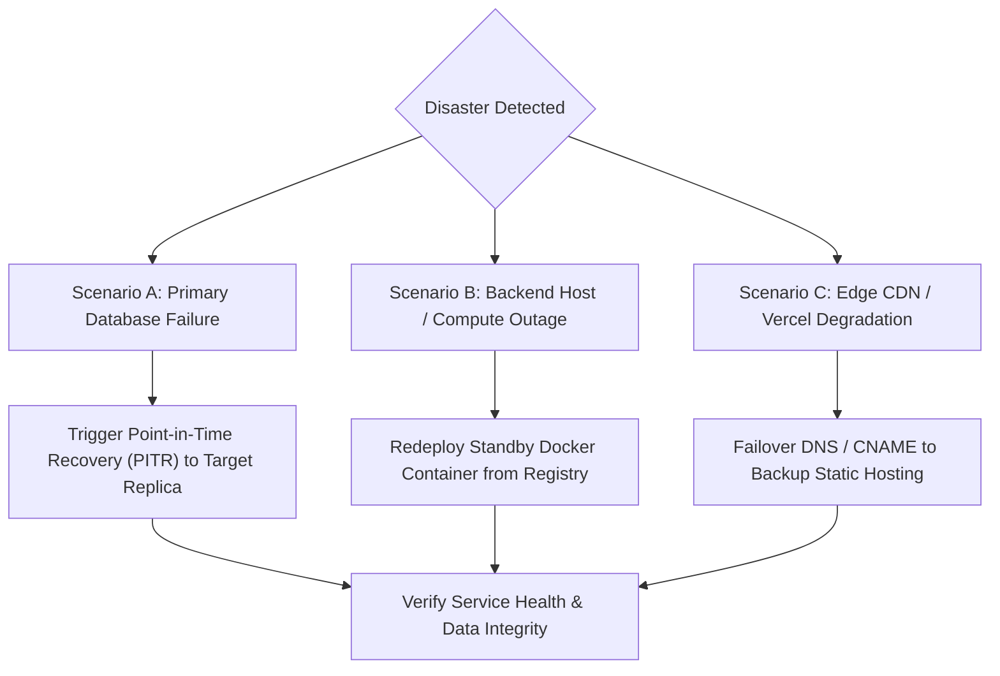

# SocietyCook Disaster Recovery & Business Continuity Plan

**Target Recovery Objectives:**
- **Recovery Point Objective (RPO):** **15 minutes** (Maximum tolerable data loss)
- **Recovery Time Objective (RTO):** **60 minutes** (Maximum tolerable downtime to restore normal operations)
**Infrastructure Scope:** TiDB Cloud Serverless MySQL, Render / Docker Application Engine, Vercel CDN Frontend.

---

## 1. Disaster Recovery Scenarios & Playbooks

### Scenario A: Primary Database Corruption / Outage
- **Action:**
  1. Freeze application traffic by putting backend in maintenance mode (`MAINTENANCE_MODE=true`).
  2. Initiate Point-in-Time Recovery (PITR) to a fresh database cluster using TiDB Cloud automated WAL logs (RPO < 15 min).
  3. Update `DATABASE_URL` in backend environment configuration.
  4. Run `npm run migrate` to verify schema integrity.
  5. Restart backend instances and confirm `/health` returns HTTP 200.

### Scenario B: Application Compute Node Failure (Render / Container Host)
- **Action:**
  1. The backend application is stateless; all session state is stored in `refresh_tokens` table in MySQL.
  2. Re-trigger zero-downtime container deploy from GitHub container registry (`ghcr.io` or Docker Hub).
  3. Verify connection pool health and background cron scheduler initialization.

### Scenario C: Cloud Provider Region Failure
- **Action:**
  1. Provision standby compute instance in secondary cloud availability zone (e.g., AWS Mumbai / ap-south-1).
  2. Direct DNS traffic via Cloudflare load balancer to secondary IP.
  3. Validate SSL certificate and API endpoints.

---

## 2. Disaster Recovery Verification Drills
- **Schedule:** Semi-annual simulated disaster drill (next drill: May 2027).
- **Procedure:** Stand up a replica environment from scratch using only backup dumps and the `enterprise-hardening` branch, verifying that complete platform restoration finishes in under 45 minutes.

