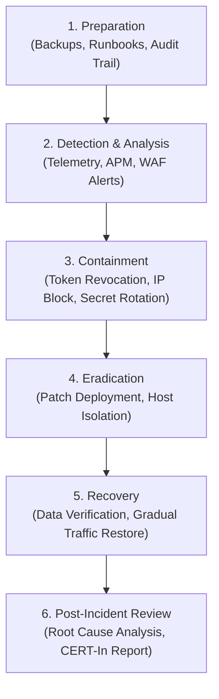

# SocietyCook Security Incident Response Plan (IRP)

**Standard:** NIST SP 800-61 Rev. 2 (Computer Security Incident Handling Guide) & CERT-In 6-Hour Reporting Mandate  
**Version:** 4.0.0  
**Effective Date:** November 2026  

---

## 1. Incident Severity Classification

| Severity Level | Definition | Response SLA | Escalation Target |
| :---: | :--- | :---: | :--- |
| **SEV-1 (Critical)** | Active data breach, unauthorized DB access, payment key compromise, core service outage affecting all societies | **15 minutes** | CTO, Lead Security Architect, CERT-In |
| **SEV-2 (High)** | Single society tenant isolation leak, authentication bypass, payment webhook failure | **30 minutes** | Engineering Lead, Backend SRE |
| **SEV-3 (Medium)** | Non-blocking API degradation, elevated 5xx error rate (>1%), suspicious brute force spike | **2 hours** | On-call Engineer |
| **SEV-4 (Low)** | Minor bug, isolated UI error, documentation discrepancy | **1 business day** | Product Backlog |

---

## 2. Six-Phase NIST Incident Lifecycle

### Phase 1: Preparation
- Continuous immutable audit logging in `audit_logs`.
- Daily automated database snapshots.
- Secure, isolated communication channels (out-of-band Signal / Phone).

### Phase 2: Detection & Analysis
- Monitor 5xx spikes, database latency anomalies, or repeated 401/403 bursts.
- Verify correlation IDs across error logs to trace attacker IP and affected user accounts.

### Phase 3: Containment
- **Credential / Token Breach:**
  Execute bulk token invalidation:
  `UPDATE refresh_tokens SET revoked = 1 WHERE user_id = ?;`
- **Compromised Secrets:**
  Rotate `JWT_SECRET` or `RAZORPAY_KEY_SECRET` immediately via environment variable injection and initiate rolling container redeployment.
- **DDoS / Abuse:**
  Block abusive IP prefixes at Cloudflare / Vercel edge WAF level.

### Phase 4: Eradication
- Identify root cause commit via git blame and audit log trace.
- Deploy hotfix commit through the automated DevSecOps pipeline (`enterprise-hardening` $\rightarrow$ `main`).

### Phase 5: Recovery
- Re-run full test suite (`npm run test`) and verification probes.
- Validate database integrity and financial ledger reconciliation.

### Phase 6: Post-Incident Activity & Regulatory Reporting
- **CERT-In Reporting:** Submit formal cybersecurity incident notification within **6 hours** of confirmation to `incident@cert-in.org.in`.
- Conduct blameless Post-Mortem within 48 hours documenting root cause, impact, timeline, and corrective engineering actions.

