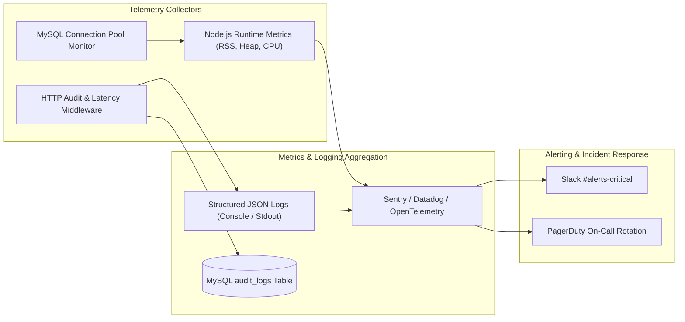

# SocietyCook Enterprise Observability & Site Reliability Engineering (SRE)

**Platform:** SocietyCook Hyperlocal Cloud Infrastructure  
**SRE Standard:** Google SRE Principles (Four Golden Signals: Latency, Traffic, Errors, Saturation)  
**Initial Availability SLO:** **99.9%** (Maximum allowable downtime: 43.8 minutes / month)  
**RPO Target:** 15 minutes | **RTO Target:** 60 minutes  

---

## 1. Golden Signals & Metric Telemetry



### Key Service Level Objectives (SLOs):
| Metric | Indicator (SLI) | Target Threshold | Monitoring Endpoint |
| :--- | :--- | :---: | :--- |
| **Availability** | Successful HTTP 2xx/3xx responses / total | $\ge$ 99.9% | `/health` & synthetic probes |
| **P95 Latency** | Time to first byte for routine API queries | < 300 ms | HTTP server duration middleware |
| **P99 Latency** | Group pricing and recommendation algorithms | < 500 ms | `/api/v1/groups/:id/recommendations` |
| **Error Budget** | Unhandled 5xx server responses | < 0.1% | Express `errorHandler` |
| **Database Pool** | Active connections / connectionLimit (15) | < 80% saturation | `db.pool._allConnections.length` |

---

## 2. Structured Logging Schema

All application events and operational logs follow standardized structured JSON:

```json
{
  "timestamp": "2026-11-20T04:30:00.000Z",
  "level": "INFO",
  "service": "societycook-api",
  "environment": "production",
  "correlationId": "req-98765-abcdef",
  "action": "PAYMENT_COMPLETED",
  "userId": 42,
  "societyId": 1,
  "resourceType": "PAYMENT",
  "resourceId": 105,
  "latencyMs": 48,
  "clientIp": "203.0.113.195",
  "userAgent": "Mozilla/5.0 (iPhone; CPU iPhone OS 17_0 like Mac OS X)"
}
```

### Log Redaction Safeguards:
- Passwords, OTP codes, credit card tokens, JWT secrets, and Aadhaar numbers are explicitly redacted from all logging middleware.
- `req.headers.authorization` is stripped before printing to stdout.

---

## 3. Health & Readiness Probes

- **Liveness Probe (`GET /health`):**
  - Confirms Node.js HTTP event loop is responding.
  - Returns `status: 'HEALTHY'`, `version: '2.0.0'`, and `uptime`.
- **Readiness Probe (`GET /api/v1/health`):**
  - Performs quick database connectivity check (`SELECT 1`).
  - Returns HTTP 200 when ready to receive traffic, HTTP 503 if database pool is exhausted.

