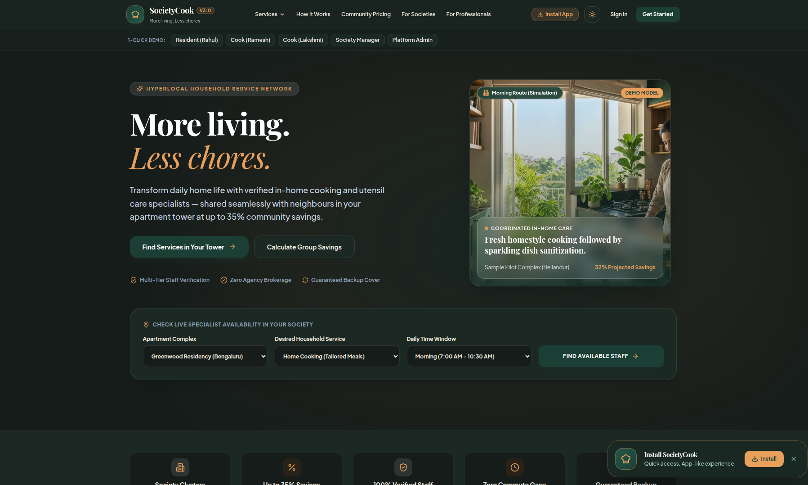
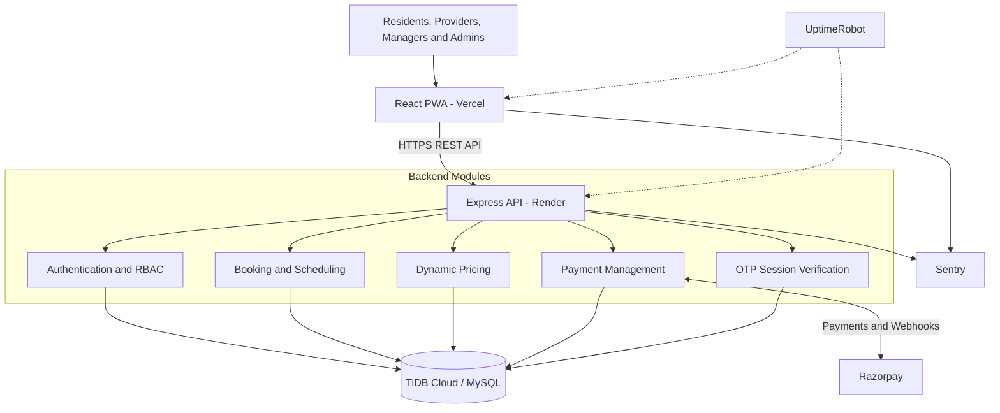
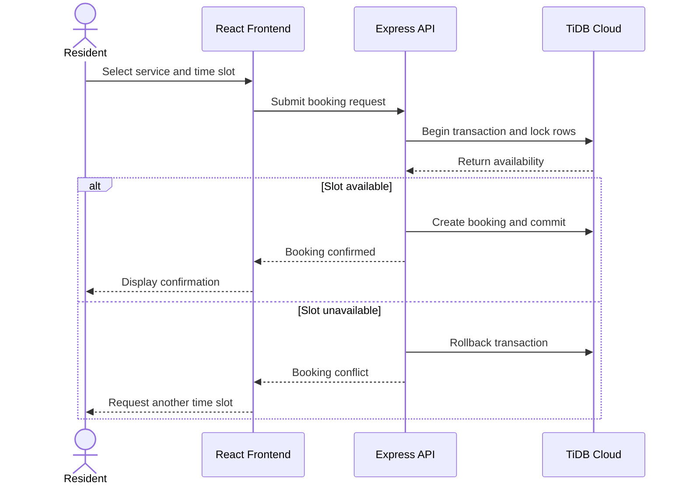
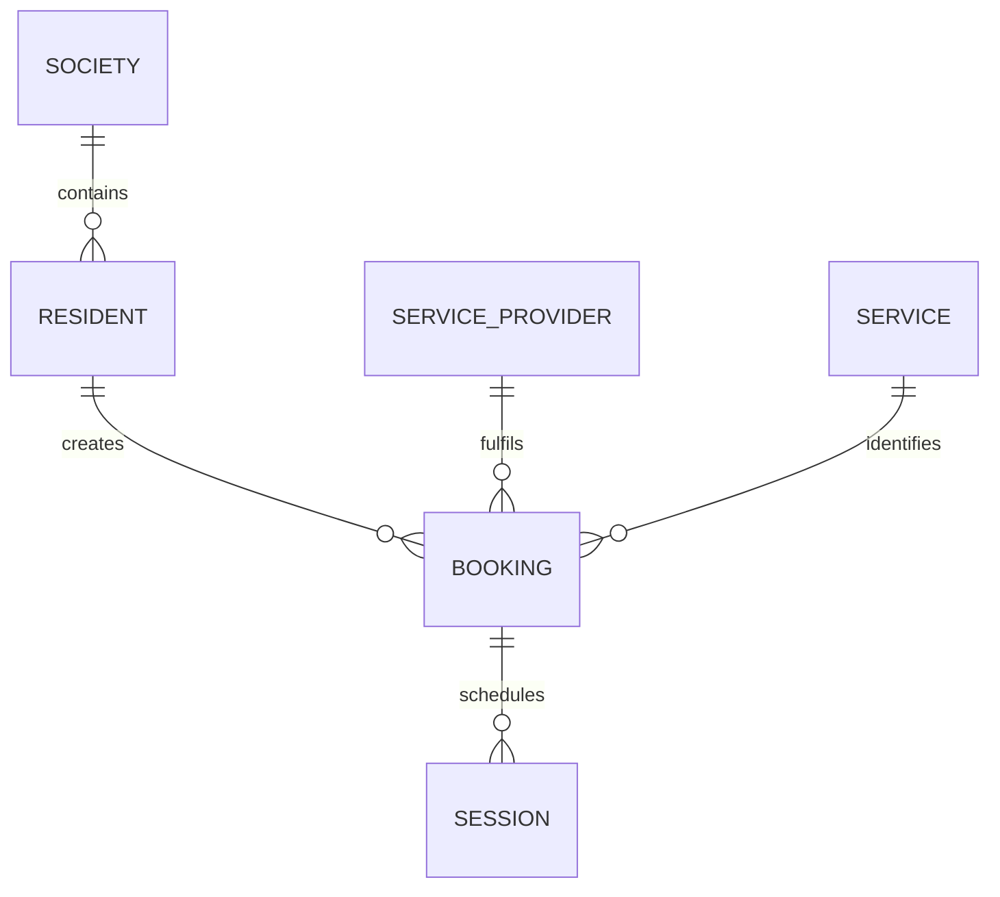

<div align="center">


# 🍳 SocietyCook v3.0

### Premium Household Services Marketplace

**More living. Less chores.**

*A happier home. A simpler everyday.*

[](https://societycook.vercel.app)
[](https://github.com/9harshithp/SocietyCook/actions/workflows/devsecops.yml)
[](https://societycook.vercel.app)
[](#automated-testing)
[](#automated-testing)
[](DATABASE.md)
[](API.md)
[](AGENTS.md)

</div>

---

## 🎬 Application Showcase

<div align="center">

[](https://societycook.vercel.app)

*SocietyCook v3.0 — household service discovery, community savings and one-click demo experiences.*

[](https://societycook.vercel.app)

### Watch the Project Demo

[](https://repoclip.io/v/e092bb24-6df1-4f4b-b0ab-8355e9f459f9)

[Watch full walkthrough →](https://repoclip.io/v/e092bb24-6df1-4f4b-b0ab-8355e9f459f9)

</div>

---

## 📌 Project Overview

SocietyCook is a hyperlocal marketplace designed to connect neighbouring households in gated residential communities with home cooks, dishwashing specialists and complete kitchen care services.

Its community-first model combines demand clustering, coordinated service scheduling and shared routes with a full-stack booking platform. The engineering focus includes transaction-safe operations, responsive interfaces, automated testing, cloud deployment and production observability.

**Live application:** [societycook.vercel.app](https://societycook.vercel.app)

## 🌟 Household Services

| Service | Description |
|---|---|
| 🍳 Professional home cooking (`COOKING`) | Fresh meals prepared in resident kitchens with personalized dietary, spice and oil preferences. |
| 🧽 Dishwashing (`DISHWASHING`) | Utensil cleaning, cookware care and sink and counter hygiene. |
| 🏡 Complete kitchen care (`COMBO`) | Coordinated cooking and dishwashing sessions. |

## 🎯 Product Differentiation

| Challenge | SocietyCook's approach |
|---|---|
| Fragmented bookings | Cluster household demand within the same society and tower. |
| Uncoordinated services | Combine cooking and utensil care into coordinated sessions. |
| Solo booking costs | Dynamic volume-based pricing with a modeled savings target of up to 35%. |
| Travel between homes | Group jobs into nearby routes, minimizing inter-household travel. |
| Provider earnings | Design for transparent earnings and fair wage targets. |
| Staff absence | Standby allocation and backup scheduling. |
| Service verification | Resident OTP-based session verification. |
| Society access | RWA gate-pass and check-in workflows. |

*Savings, earnings and replacement times are product targets or modeled estimates, not independently verified commercial outcomes.*

## 🚀 Platform Features

| Resident | Service provider | Society manager | Platform admin |
|---|---|---|---|
| Service discovery | Assigned schedules | Demand clustering | Provider verification |
| Booking and cancellation | Session check-in/out | Society coordination | Booking oversight |
| Recurring sessions | Earnings view | Gate-pass workflows | Backup coordination |
| Meal preferences | Leave requests | Demand insights | Operational analytics |

---

## 💻 Technology Stack

<div align="center">


</div>

| Layer | Technology |
|---|---|
| Frontend | React, Vite, JavaScript |
| Backend | Node.js, Express.js |
| Database | MySQL 8 (local), TiDB Cloud (production) |
| API | REST, OpenAPI / Swagger |
| Hosting | Vercel, Render |
| Containers | Docker, Docker Compose |
| Automated tests | Vitest, Playwright |
| CI/CD | GitHub Actions — DevSecOps pipeline |
| Observability | Sentry, UptimeRobot |
| Performance & SEO | Lighthouse, Google Search Console |

## 🏗️ System Architecture

SocietyCook follows a modular monolith architecture with
independently deployed frontend and backend applications.



### Booking Sequence Diagram



### Engineering Design

| Design decision | Purpose |
|---|---|
| Modular monolith | Maintainable business modules |
| Database transactions | Consistent booking operations |
| Row-level locking | Concurrent booking protection |
| Idempotent payment processing | Prevent duplicate payment effects |
| Role-based access control | Account-level authorization |
| OTP verification | Service session validation |
| Separate deployments | Independent frontend and backend delivery |
| Production monitoring | Error tracking and availability monitoring |

See [ARCHITECTURE.md](ARCHITECTURE.md) and [TRD.md](TRD.md)
for detailed engineering design.

## 🗄️ Conceptual Database Relationships



This is a conceptual domain diagram, not a reverse-engineered physical schema. Refer to [DATABASE.md](DATABASE.md) for actual tables, indexes and relationships.

## ⚡ Engineering Highlights

| Engineering area | Implementation |
|---|---|
| Concurrency | Transaction-based booking creation with row-level locking |
| Data integrity | Transactional booking and cancellation |
| Scheduling | Recurring service sessions and community coordination |
| Pricing | Dynamic service pricing and volume-based discounts |
| Authentication | Protected application flows and role-based access |
| Reliability | Database backups and recovery verification |
| Quality | Automated backend, E2E and responsive UI testing |
| Operations | Separate frontend/backend deployment and production monitoring |

---

## 🧪 Automated Testing

<a id="automated-testing"></a>

| Suite | Reported passing tests |
|---|---:|
| Vitest backend | 103 |
| Playwright E2E | 22 |
| **Total passing** | **125** |

Counts are from the latest supplied project test report; live results may change with each commit. See the [DevSecOps workflow](https://github.com/9harshithp/SocietyCook/actions/workflows/devsecops.yml) for current pipeline status.

Coverage areas include dynamic pricing for all three services, scheduling, recommendations, booking lifecycles, authentication and responsive user flows.

### Run backend tests

```bash
cd backend
npm test
```

See [TESTING.md](TESTING.md) for test strategy and E2E instructions.

## 📡 Production Monitoring & Reliability

| Tool | Purpose |
|---|---|
| Sentry | Frontend and backend error tracking |
| UptimeRobot | Frontend and API availability monitoring |
| TiDB Cloud backups | Database recovery and resilience |
| Lighthouse | Performance and accessibility auditing |
| Google Search Console | Search indexing and visibility |

## 🔐 Security & DevSecOps

- Authentication and role-based authorization.
- OTP-based service verification.
- Transactional data operations.
- Environment-variable-based configuration.
- Credential rotation and database backup practices.
- Automated CI/CD checks through GitHub Actions.

See [SECURITY.md](SECURITY.md) for security design and the workflow for current audit results. Security checks do not guarantee that an application is free of vulnerabilities.

## 📈 Performance, SEO & User Experience

- Responsive layouts and multi-viewport regression testing.
- Optimized font assets.
- Lighthouse performance auditing.
- Sitemap and robots.txt.
- Google Search Console verification.
- Installable application experience, as shown in the homepage screenshot.

## 🔌 API Documentation

REST endpoints cover authentication, bookings, services, scheduling and administration.

Local Swagger documentation: [http://localhost:5000/api/v1/docs](http://localhost:5000/api/v1/docs)

See [API.md](API.md) for endpoint specifications.

---

## 🚀 Quick Start

### Prerequisites

- Node.js v18+ (or the version required by the current package configuration).
- Docker and Docker Compose.
- Git and npm.

### 1. Clone the repository

```bash
git clone https://github.com/9harshithp/SocietyCook.git
cd SocietyCook
git checkout main
```

The earlier v3 development instructions used `feature/societycook-v3`. Use that branch only when working on its specific development snapshot.

### 2. Start the local database

```bash
docker compose up -d db
```

The supplied configuration uses host port `3307` to avoid collisions with local MySQL on port `3306`.

### 3. Install and configure the backend

```bash
cd backend
npm install
```

Configure local environment variables using [DEPLOYMENT.md](DEPLOYMENT.md). Use a local development database, not the production database, for seed data.

### 4. Initialize the local database

```bash
node migrations.js
node seed.js
```

### 5. Start the backend

```bash
npm run start
```

API: `http://localhost:5000`

### 6. Start the frontend

In a separate terminal, from the repository root:

```bash
cd frontend
npm install
npm run dev
```

Frontend: `http://localhost:5173`

## ☁️ Deployment

| Component | Platform |
|---|---|
| Frontend | Vercel |
| Backend | Render |
| Production database | TiDB Cloud |
| CI/CD | GitHub Actions |

See [DEPLOYMENT.md](DEPLOYMENT.md) for configuration and operational instructions.

## 👥 One-Click Demo Personas

Explore the demonstration workflows using the persona switcher.

| Persona | Example workflows |
|---|---|
| Resident — Rahul Sharma | Meal planning, session details, group savings |
| Cook — Ramesh Kumar | Routes, session verification, earnings |
| Cook — Lakshmi Devi | Schedules, leave requests |
| Society Manager | Gate clearance, tower clusters, demand heatmaps |
| Platform Admin | Provider verification, standby dispatch, forecasting |

Demo personas represent sample workflows and data rather than real customer records.

## 📚 Technical Documentation

| Document | Description |
|---|---|
| [PRD.md](PRD.md) | Product requirements |
| [TRD.md](TRD.md) | Technical requirements |
| [ARCHITECTURE.md](ARCHITECTURE.md) | Modular monolith and system design |
| [DATABASE.md](DATABASE.md) | MySQL schema, relationships and indexes |
| [API.md](API.md) | REST API specifications |
| [ALGORITHMS.md](ALGORITHMS.md) | Pricing, scheduling and recommendations |
| [SECURITY.md](SECURITY.md) | Security, RBAC, OTP and audit design |
| [TESTING.md](TESTING.md) | Test strategy and coverage |
| [DEPLOYMENT.md](DEPLOYMENT.md) | Cloud operations runbook |
| [CHANGELOG.md](CHANGELOG.md) | Version history |
| [IMPLEMENTATION_PROGRESS.md](IMPLEMENTATION_PROGRESS.md) | Milestone tracking |
| [AGENTS.md](AGENTS.md) | Engineering guidelines |

---

## 🤝 Contributing

Suggestions and improvements are welcome. Open an issue to discuss changes, create a feature branch, run the relevant tests and submit a pull request.

## 👨‍💻 Developer

<div align="center">

**Harshith P**

Backend Engineer | Full Stack Developer

[](https://github.com/9harshithp)
[](https://www.linkedin.com/in/harshithp914)
[](mailto:harshithp914@gmail.com)

⭐ If you find SocietyCook interesting, consider starring the repository.


</div>
