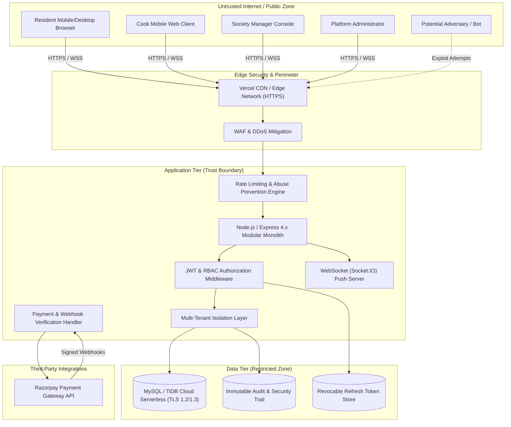

# SocietyCook Enterprise Threat Model (STRIDE)

**Document Version:** 4.0.0  
**Classification:** Enterprise Confidential  
**Assessment Date:** November 2026  
**Scope:** Public Web App, REST APIs, WebSocket Server, MySQL Database, Payments, Auth & Multi-Tenant Society Workflows.

---

## 1. System Overview & Trust Boundaries

SocietyCook is a hyperlocal household services platform operating across residential housing societies in Bengaluru, India. Each residential society acts as a strict multi-tenant boundary.

---

## 2. Assets & Data Sensitivity Matrix

| Asset | Sensitivity | Impact of Breach | Storage / In-Transit Protection |
| :--- | :---: | :--- | :--- |
| **User Passwords** | CRITICAL | Account takeover, credential stuffing | Argon2id / bcrypt (cost 12), never logged |
| **JWT Access & Refresh Tokens** | HIGH | Session hijacking, impersonation | SHA-256 hashed in DB, short-lived (2h), TLS 1.3 |
| **Resident Flat & Phone Numbers** | HIGH | Privacy violation, physical stalking | Role-scoped access, masked in public APIs |
| **Aadhaar / Identity Proofs** | CRITICAL | Identity theft, regulatory fine (DPDP) | Masked, no raw storage in public web roots |
| **Payment Webhook Signatures** | HIGH | Financial theft, fake subscriptions | HMAC-SHA256 signature validation with raw body |
| **Ledger & Payout Records** | HIGH | Disputed earnings, economic loss | ACID transactions with row-level pessimistic locks |
| **OTP Attendance Verification** | MEDIUM | Fraudulent attendance marking | Single-use 4-digit token generated on server |

---

## 3. STRIDE Threat Analysis by Component

### 3.1. Authentication & Session Management
- **Spoofing (S)**:
  - *Threat*: Attacker guesses weak passwords or replays expired JWTs.
  - *Mitigation*: Bcrypt cost 12 hashing, strict expiration (2h), cryptographically random 40-byte refresh tokens with SHA-256 hashed storage, token rotation on use.
- **Tampering (T)**:
  - *Threat*: Modifying JWT claims (`role`, `societyId`, `sub`).
  - *Mitigation*: HS256 with cryptographically generated 256-bit secret. Server rejects algorithmic `none` attacks and verifies signature before decoding.
- **Repudiation (R)**:
  - *Threat*: User denies making a booking or modifying attendance.
  - *Mitigation*: Centralized `audit_logs` recording `user_id`, `action`, `resource_type`, `ip_address`, `user_agent`, and timestamp.
- **Information Disclosure (I)**:
  - *Threat*: User enumeration via registration or login error responses.
  - *Mitigation*: Generic error messaging (`Invalid email or password`), uniform response timing.
- **Denial of Service (D)**:
  - *Threat*: Credential stuffing or registration flooding.
  - *Mitigation*: Strict per-IP rate limiter (5 requests / 15 minutes) on `/api/v1/auth/login` and `/api/v1/auth/register`.
- **Elevation of Privilege (E)**:
  - *Threat*: Public self-registration as `ADMIN` or `SOCIETY_MANAGER`.
  - *Mitigation*: Public registration strictly limited to `RESIDENT` and `COOK`. `ADMIN` and `SOCIETY_MANAGER` roles require verified administrator approval.

---

### 3.2. Multi-Tenant Society Isolation
- **Spoofing / Elevation of Privilege**:
  - *Threat*: Resident from Society A queries or joins cook groups or views household schedules in Society B (BOLA/IDOR).
  - *Mitigation*: Tenant validation middleware (`requireSameSocietyOrAdmin`) and server-side SQL filters `WHERE society_id = ?` matching `req.user.society_id`.
- **Information Disclosure**:
  - *Threat*: Society manager querying another society's analytics or invoices.
  - *Mitigation*: Authorization check verifying `req.user.society_id === targetSocietyId` for all society-scoped routes.

---

### 3.3. Bookings, Dynamic Pricing & Payments
- **Tampering (T)**:
  - *Threat*: Malicious client alters booking price or discount in the HTTP POST payload.
  - *Mitigation*: All prices and discounts are calculated strictly server-side using `calculateGroupPricing` and validated against database pricing rules. Client-supplied price parameters are completely ignored.
- **Tampering / Spoofing in Payments**:
  - *Threat*: Fake payment confirmation submitted via browser or forged webhook.
  - *Mitigation*: Razorpay HMAC-SHA256 signature verification over raw request body. Never trust payment status submitted by frontend. Pessimistic row locking (`FOR UPDATE`) on booking state transitions to prevent double-confirmations.
- **Denial of Service / Race Conditions**:
  - *Threat*: Concurrent booking requests for the same cook slot (double booking).
  - *Mitigation*: Database transactions with `SELECT ... FOR UPDATE` and unique constraints on `(cook_id, service_date, start_time)`.

---

### 3.4. Attendance, OTP & Dispute Verification
- **Spoofing (S)**:
  - *Threat*: Cook marks attendance without physically arriving at the resident's home.
  - *Mitigation*: Server-generated single-use 4-digit OTP provided only on the resident's authenticated dashboard. Cook must enter the OTP upon arrival.
- **Tampering (T)**:
  - *Threat*: Unauthorized user altering session status to `COMPLETED` or `DISPUTED`.
  - *Mitigation*: Only the assigned cook can check in/out; only the booking resident can dispute.

---

## 4. Threat Matrix Summary

| Threat ID | Component | STRIDE Category | Severity | Pre-Mitigation Status | Post-Mitigation Status |
| :--- | :--- | :---: | :---: | :---: | :---: |
| **TM-01** | CORS Configuration | S, I | **CRITICAL** | VULNERABLE (Wildcard reflection) | **RESOLVED** (Strict allowlist) |
| **TM-02** | User Registration | E | **HIGH** | VULNERABLE (Manager self-reg) | **RESOLVED** (Restricted roles) |
| **TM-03** | Review Creation | T, S | **HIGH** | VULNERABLE (IDOR review forgery) | **RESOLVED** (Ownership checked) |
| **TM-04** | Society Analytics | I | **HIGH** | VULNERABLE (Cross-tenant leak) | **RESOLVED** (Tenant boundary check) |
| **TM-05** | Group Activation | E, T | **HIGH** | VULNERABLE (BOLA / Unauth activate) | **RESOLVED** (Creator/Admin auth) |
| **TM-06** | Razorpay Payments | T, S | **HIGH** | VULNERABLE (Missing webhook HMAC) | **RESOLVED** (Raw HMAC webhook) |
| **TM-07** | Demo Payment Mode | T | **HIGH** | VULNERABLE (Enabled by default) | **RESOLVED** (Disabled in prod) |
| **TM-08** | Zod Dependency | D | **MEDIUM** | VULNERABLE (GHSA-mrhx-c7xc-m3w5) | **RESOLVED** (Dependency patched) |
| **TM-09** | Auth Rate Limiting | D, S | **MEDIUM** | VULNERABLE (Loose 300 req/min) | **RESOLVED** (5 req/15min login) |
| **TM-10** | Security Headers | T, I | **MEDIUM** | VULNERABLE (CSP disabled) | **RESOLVED** (Strict Helmet & CSP) |
| **TM-11** | SEO Crawl Control | I | **LOW** | MISSING (No robots/sitemap) | **RESOLVED** (Robots.txt & Sitemap) |
| **TM-12** | Container Security | E | **MEDIUM** | MISSING (No Dockerfile) | **RESOLVED** (Non-root multi-stage) |

